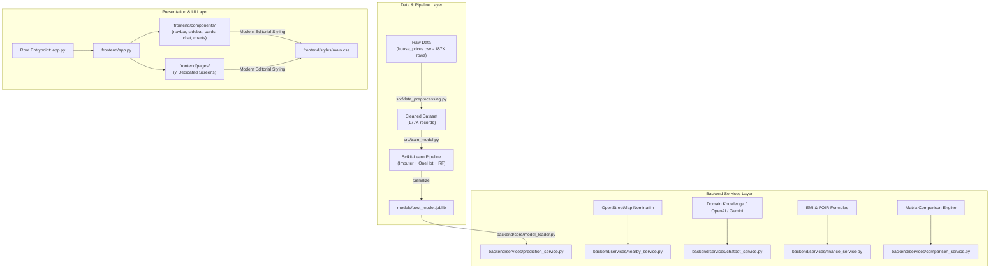

# DwellIQ — Intelligent Real-Estate Decision Platform 🏡

**Academic Title:** AI-Powered Residential Valuation, Mortgage Analytics & Decision Platform  
**Technology Stack:** Python 3.10+, Scikit-Learn, Streamlit, Pandas, NumPy, SQLite3, Joblib, Pytest, Matplotlib  
**Live Deployment:** [https://dwelliq-by-vaishnavi.streamlit.app/](https://dwelliq-by-vaishnavi.streamlit.app/)  
**GitHub Repository:** [https://github.com/vaishnavi-naik07/DwellIQ---House-Price-Prediction](https://github.com/vaishnavi-naik07/DwellIQ---House-Price-Prediction)  

---

## 🌟 Overview & Architecture

**DwellIQ** is a decoupled, modern real-estate decision platform designed for Indian urban housing markets. Trained on 177,000+ transaction records across 80+ cities, the system provides transparent property valuations, mortgage EMI analytics, OpenStreetMap civic infrastructure discovery, side-by-side property comparison, an advanced AI property advisor, and a salted PBKDF2 authentication vault.

### High-Level Architectural Flowchart



---

## 🏛️ Project Directory Structure

```text
DwellIQ/
├── app.py                          # Root Streamlit Cloud entrypoint
│
├── frontend/                       # Streamlit UI layer
│   ├── app.py                      # Main frontend app with page routing
│   ├── pages/
│   │   ├── dashboard.py            # Overview hero, quick actions, market stats
│   │   ├── estimate_property.py    # 3-section estimation form & valuation card
│   │   ├── ai_assistant.py         # DwellIQ AI — Your Personal Property Advisor
│   │   ├── nearby_essentials.py    # Live OpenStreetMap POI infrastructure search
│   │   ├── compare_properties.py   # Multi-property comparison matrix & badges
│   │   ├── emi_calculator.py       # Mortgage EMI breakdown & FOIR affordability
│   │   └── model_insights.py       # Leaderboard table, training charts & notes
│   ├── components/
│   │   ├── navbar.py               # Top brand bar, header chips & footer
│   │   ├── sidebar.py              # Navigation menu & user auth widget
│   │   ├── property_card.py        # Valuation cards, property cards & spec pills
│   │   ├── chat_interface.py       # Chat bubbles, prompt cards & input controls
│   │   ├── auth_modal.py           # Login / register authentication modal
│   │   └── charts.py               # EMI donut chart & evaluation figures
│   ├── styles/
│   │   └── main.css                # Warm cream, forest green & sage design system
│   └── assets/
│       └── images/
│           └── luxury_home.jpg     # High-res hero visual
│
├── backend/                        # Reusable application logic & services
│   ├── __init__.py
│   ├── core/
│   │   ├── __init__.py
│   │   ├── config.py               # App configuration, constants & project paths
│   │   └── model_loader.py         # Model bundle loading & cache management
│   ├── services/
│   │   ├── __init__.py
│   │   ├── prediction_service.py   # Pipeline prediction & INR formatting
│   │   ├── chatbot_service.py      # LLM handler & domain fallback engine
│   │   ├── nearby_service.py       # OpenStreetMap Nominatim geospatial queries
│   │   ├── finance_service.py      # Exact EMI & affordability calculations
│   │   └── comparison_service.py   # Property comparison & highlight analytics
│   └── utils/
│       ├── __init__.py
│       ├── validators.py           # Email, password, property & EMI validators
│       └── formatters.py           # Currency & number notation formatters
│
├── src/                            # ML and data-processing source code
│   ├── __init__.py
│   ├── data_preprocessing.py       # Data cleaning & unit normalization
│   ├── train_model.py              # Model training & serialization
│   ├── evaluate_model.py           # Model evaluation & figure generation
│   ├── eda.py                      # Exploratory data analysis
│   ├── inspect_dataset.py          # Dataset structure inspection utility
│   ├── inspect_prices.py           # Price conversion validation utility
│   ├── auth.py                     # PBKDF2 authentication & user management
│   └── nearby_places.py            # City coordinates & Nominatim POI queries
│
├── data/
│   ├── raw/                        # Original scraped listings (house_prices.csv)
│   ├── processed/                  # Cleaned 177K+ dataset
│   └── secure/                     # SQLite user & valuation database
│
├── models/
│   └── best_model.joblib           # Trained Random Forest Scikit-learn pipeline
│
├── notebooks/
│   └── 01_exploratory_data_analysis.ipynb
│
├── reports/
│   ├── DATA_DICTIONARY.md          # Feature definitions & data provenance
│   ├── EDA_REPORT.md               # Exploratory data analysis insights
│   ├── MODEL_EVALUATION.md         # MAE, RMSE, R² & explainability breakdown
│   ├── VIVA_QUESTIONS.md           # Examiner Q&A & presentation guide
│   ├── model_comparison.csv        # Benchmarked model metrics
│   └── figures/                    # Saved figures (feature importance, etc.)
│
├── tests/
│   ├── test_chatbot.py             # DwellIQ AI advisor & financial intent tests
│   ├── test_dwelliq.py             # Security, model inference & nearby places tests
│   └── test_preprocessing.py       # Preprocessing, validators & financial tests
│
├── scripts/                        # Thin runner scripts that invoke src/
│   ├── run_preprocessing.py        # → src.data_preprocessing.preprocess_data()
│   ├── run_training.py             # → src.train_model.train_and_save_model()
│   └── run_eda.py                  # → src.eda.run_comprehensive_eda()
│
├── .streamlit/
│   └── config.toml                 # Streamlit theme configuration
├── requirements.txt                # Production Python dependencies
├── .gitignore                      # Security rules: databases, secrets, venvs
├── .env.example                    # Environment variable template
└── README.md                       # This file
```

---

## ✨ Dedicated Modules & Functionality

1. **Overview Dashboard (`frontend/pages/dashboard.py`):**
   - Editorial headline: *"Find Your Place. Understand Its Value."*
   - Real-time empirical statistics: 177,847 verified records, ₹78.0 Lakh pan-India median price, 81 cities, 1,100 sq.ft median area.
   - Interactive City Price Explorer for instant benchmark comparisons across top metropolitan hubs.

2. **Estimate a Property (`frontend/pages/estimate_property.py`):**
   - Three structured sections: Structural & Core Details, Legal & Transaction Preferences, Nearby Essentials Context.
   - Model inference using the trained ensemble `RandomForestRegressor`.
   - Results presented in a premium valuation hero card with predicted INR price, ₹/sq.ft rate, and transparent model metrics (MAE ~₹18.16L, holdout R²).
   - Seamless one-click actions:
     - `📊 Calculate Monthly EMI →`
     - `⚖️ Compare Listing →`
     - `💬 Discuss with DwellIQ AI →` (passes full estimate context directly to the AI Advisor).

3. **DwellIQ AI — Your Personal Property Advisor (`frontend/pages/ai_assistant.py`):**
   - Intelligent conversational advisor designed specifically for home-buyers in India.
   - **7 Quick-Action Prompt Cards:**
     - 🔍 *Explain My Price* — Understand how model features drive the predicted valuation.
     - 💰 *Can I Afford It?* — Evaluate properties against personal income and savings using the 30/40 rule.
     - 📊 *Calculate My EMI* — Compute monthly amortization, principal, interest, and total repayment.
     - ⚖️ *Compare Properties* — Explore trade-offs between configurations, micro-markets, and ready vs under-construction.
     - 📍 *Find Nearby Essentials* — Review essential infrastructure benchmarks (hospitals, schools, metro).
     - 📋 *Home-Buying Checklist* — Crucial RERA, title deed, encumbrance, and OC/CC verification steps.
     - 📐 *Understand Property Terms* — Clear definitions of Carpet Area vs Built-Up vs Super Built-Up, and UDS.
   - **Context-Aware Discussions:** Automatically references the user's active property estimate when navigated from the valuation tool.
   - **Real AI & Deterministic Fallback:** Supports live OpenAI (`gpt-4o-mini`) and Google Gemini (`gemini-1.5-flash`) via `st.secrets` or `.env`. When unconfigured, it runs on DwellIQ's built-in deterministic financial, geospatial, and real-estate knowledge engine with explicit attribution.
   - **Conversation Controls:** New Chat, Clear Chat with confirmation, and Retry/Regenerate last query.

4. **Nearby Essentials (`frontend/pages/nearby_essentials.py`):**
   - Civic amenities and POI verification using live OpenStreetMap Nominatim.
   - Filter by categories: Hospitals, Schools, Supermarkets, Metro stations, Gyms, Parks, etc.
   - Configurable radius: 1 km, 3 km, 5 km, 10 km, with Haversine distance calculations.

5. **Compare Properties (`frontend/pages/compare_properties.py`):**
   - Side-by-side analysis of 2 or 3 property listings.
   - Comparison matrix evaluating Total Outlay, Usable Carpet Area, Rate per sq.ft, Configuration, and Furnishing.
   - Strategic highlight badges identifying the lowest price, best value rate, and largest space.

6. **EMI & Affordability Calculator (`frontend/pages/emi_calculator.py`):**
   - Tab 1: Mortgage EMI calculation using standard mathematical formula:
     $$\text{EMI} = \frac{P \times R \times (1+R)^N}{(1+R)^N - 1}$$
   - Matplotlib payment breakdown donut chart (Principal vs Interest).
   - Tab 2: Affordability assessment based on standard 40–50% FOIR (Fixed Obligation to Income Ratio).

7. **Model Insights (`frontend/pages/model_insights.py`):**
   - Official model benchmark leaderboard from `model_comparison.csv`.
   - Empirical visualizations: Random Forest feature importances and MAE comparison.
   - Honest academic discussion of real-estate variance and $R^2$ scores for college review and viva.

---

## 🚀 Local Installation & Execution

### 1. Clone the Repository
```bash
git clone https://github.com/vaishnavi-naik07/DwellIQ---House-Price-Prediction.git
cd DwellIQ---House-Price-Prediction
```

### 2. Set Up Virtual Environment & Dependencies
```bash
python -m venv venv
# Windows:
venv\Scripts\activate
# Linux/macOS:
source venv/bin/activate

pip install -r requirements.txt
```

### 3. Configure Environment Variables (Optional)
```bash
# Windows PowerShell:
Copy-Item .env.example .env
# Linux/macOS:
cp .env.example .env
```
Optional: Add your `OPENAI_API_KEY` or `GEMINI_API_KEY` in `.env` or in Streamlit Cloud Secrets for live LLM mode. If omitted, DwellIQ automatically operates in deterministic domain engine mode.

### 4. Run the Streamlit Application
```bash
python -m streamlit run app.py
```
Open your browser at **`http://localhost:8501`**.

---

## 🧪 Automated Testing Suite

Run the full pytest suite:

```bash
python -m pytest tests/ -v
```

**Test Results: 41 Passed, 0 Failed (100% Pass Rate)**
- **Chatbot & Advisory (`test_chatbot.py`):** System prompt constraints, price explainability, active context awareness, EMI calculations, budget affordability, RERA checklists, property terms, nearby queries.
- **Security & Integrity (`test_dwelliq.py`):** PBKDF2 password hashing, verification, email validation, rate limiting, model bundle loading, standard inference, extreme luxury properties, unseen categories, missing value imputation.
- **Preprocessing & Finance (`test_preprocessing.py`):** Currency parsing (Lakhs, Crores, ₹), BHK regex extraction, carpet area conversion, EMI formulas, FOIR calculations, property matrix comparison.

---

## 🚢 Streamlit Cloud Deployment Commands

To push all changes to GitHub and automatically deploy on Streamlit Community Cloud:

```bash
# 1. Review status
git status

# 2. Stage all restructured files and components
git add .

# 3. Commit with descriptive summary
git commit -m "refactor: clean separation into frontend, backend, and src layers"

# 4. Push to remote main branch
git push origin main
```

Streamlit Cloud will automatically detect the push to `main` and redeploy using the root `app.py` entrypoint.
