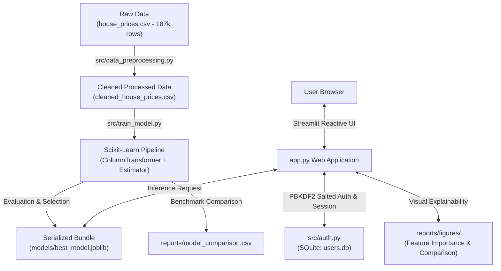

# DwellIQ — Smarter Estimates. Better Decisions. 🏡

**Academic Title:** House Price Prediction Using Linear Regression and Random Forest  
**Technology Stack:** Python 3.10+, Scikit-Learn, Streamlit, Pandas, NumPy, SQLite, Joblib, Pytest  

---

## 🌟 Overview & Architecture

**DwellIQ** is a machine learning-powered residential property valuation platform tailored for Indian urban real estate markets. Trained on 187,000+ listing records across 80+ cities, the system provides transparent price estimations, empirical error intervals, feature explainability, and a salted PBKDF2 authentication vault.



---

## ✨ Features & Capabilities

1. **Modern Aesthetic Real-Estate Interface:**
   - Curated Ivory (`#FAF9F5`) and Forest Green (`#2D5A43`) design language.
   - High-resolution architectural villa hero visual stored locally (`assets/luxury_home.jpg`).
   - Clean, accessible input forms with dual Indian Rupee denomination display (**₹ Lakh** / **₹ Cr**).

2. **Machine Learning Pipeline & Inference:**
   - Multi-signal evaluation: 12 attributes including location (80+ Indian cities), BHK, carpet area, bathrooms, balconies, floor, facing, furnishing, ownership, and parking.
   - Robust `ColumnTransformer` featuring median and most-frequent imputation, plus `OneHotEncoder(handle_unknown='ignore')`.
   - Empirically grounded expected error intervals ($\hat{y} \pm \text{MAE}$) instead of misleading certainty.

3. **Authentication & User Vault:**
   - Salted `PBKDF2-HMAC-SHA256` password hashing with 200,000 iterations.
   - Parameterized SQLite queries preventing SQL injection vulnerabilities.
   - Brute-force rate limiting (locks after 5 failed login attempts in 5 minutes).
   - Authenticated "My Saved Estimates" tab to track valuation history.

4. **Model Explainability & Academic Honesty:**
   - Feature importance bar chart visualizing tree impurity reductions.
   - Genuine performance reporting on held-out test splits (Random Forest MAE: ~₹18.16 Lakh vs Linear Regression MAE: ~₹43.08 Lakh).
   - Documented discussion on unobserved hyper-local real-estate variance and R² determination score.

---

## 🚀 Installation & Local Setup

### 1. Clone or Open Project
```bash
cd "c:\My Projectssss\DwellIQ"
```

### 2. Install Dependencies
```bash
pip install -r requirements.txt
```

### 3. Configure Environment Variables (Optional)
Copy `.env.example` to `.env`:
```bash
cp .env.example .env
```

### 4. Run the Web Application
```bash
python -m streamlit run app.py
```
Open your browser at: **`http://localhost:8501`**

---

## 🧪 Running Automated Tests

A test suite verifying authentication, hashing, rate limiting, preprocessing regex, model loading, and inference robustness is included in `tests/test_dwelliq.py`:

```bash
python -m pytest tests/ -v
```

**Test Coverage Summary (15 Passed, 0 Failed):**
- Password hashing & constant-time HMAC verification
- Email validation & RFC compliance regex
- Password complexity validation
- Duplicate user registration prevention & case normalization
- User authentication success/failure flows
- Brute-force rate limiting protection
- Saved estimation history isolation per user
- Rupee currency string parsing (Lac, Lakh, Cr, Crore)
- Title BHK extraction regex
- Carpet area square-foot normalization
- Model bundle serialization and dictionary compatibility
- Inference on standard residential listings
- Graceful handling of unseen cities and categorical inputs
- Missing and zero numeric input robustness
- Scale validation on luxury properties (> ₹10 Cr)

---

## 📂 Project Structure

```
DwellIQ/
├── app.py                      # Main Streamlit web application & UI
├── requirements.txt            # Python dependencies
├── .env.example                # Template for environment configuration
├── .gitignore                  # Security rules: databases, secrets, virtualenvs
├── assets/
│   └── luxury_home.jpg         # Local luxury villa hero image
├── data/
│   ├── raw/
│   │   └── house_prices.csv    # 187k+ raw housing listings
│   ├── processed/
│   │   └── cleaned_house_prices.csv # Cleaned training dataset
│   └── secure/
│       └── users.db            # Parameterized SQLite user & history database
├── models/
│   └── best_model.joblib       # Fitted Scikit-Learn Random Forest pipeline
├── reports/
│   ├── DATA_DICTIONARY.md      # Detailed column definitions & provenance
│   ├── EDA_REPORT.md           # Exploratory data analysis insights
│   ├── MODEL_EVALUATION.md     # MAE, RMSE, R² & explainability breakdown
│   ├── VIVA_QUESTIONS.md       # Viva voce questions, presentation guide & answers
│   ├── model_comparison.csv    # Benchmarked model metrics
│   └── figures/                # Saved charts (feature importance, EDA, distributions)
├── src/
│   ├── auth.py                 # PBKDF2 authentication, rate limiting, SQLite queries
│   ├── data_preprocessing.py   # Data cleaning, regex parsers, column handling
│   ├── evaluate_model.py       # Generates explainability charts & eval report
│   └── train_model.py          # Fair train-test comparison & model serialization
└── tests/
    └── test_dwelliq.py         # Automated pytest suite (15 test cases)
```

---

## 🎓 Academic Viva Reference

A full guide containing answers to common evaluator questions regarding $R^2$ variance, data leakage prevention, feature importance vs causality, and security design is located in [`reports/VIVA_QUESTIONS.md`](file:///c:/My%20Projectssss/DwellIQ/reports/VIVA_QUESTIONS.md).
